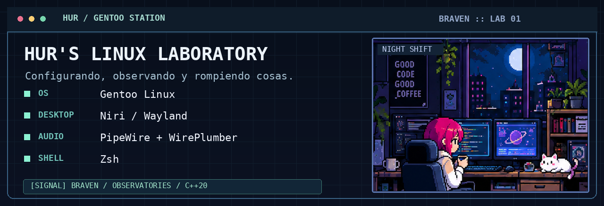

<!-- HurBC / README v3 — Markdown + HTML compatible con GitHub -->

# ¡Hola! Soy HurBC 👾

### Fullstack developer · C# / Rust / C++ · Linux enthusiast

Soy un desarrollador chileno al que le gusta **entender cómo funcionan las cosas por dentro**, experimentar con tecnologías y construir proyectos desde cero.

Me gustan el café, los gatos, los videojuegos y complicarme la vida haciendo cosas que probablemente ya existen. ☕🐈

---

## ☕ Un poquito sobre mí

<table>
  <tr>
    <td width="50%" valign="top">
      <h3>Programador de día, experimentador de noche</h3>
      
Me interesan tanto las aplicaciones completas como el software que trabaja cerca del sistema operativo. Si algo hace magia, quiero entender cómo funciona por debajo.

      
❤️ <b>Favoritos:</b> C#, Rust y C++. 
      🐧 <b>Para experimentar:</b> Gentoo Linux. 
      🎮 <b>Cuando no compilo:</b> juegos, música y proyectos. 
      🐍 <b>Python:</b> lo uso cuando toca. No significa que seamos amigos.

      
<i>Mi hobby es empezar un proyecto que necesita otros cinco proyectos.</i>

    </td>
    <td width="50%" align="center" valign="middle">
      
    </td>
  </tr>
</table>

---

## 💻 Lenguajes y tecnologías

### 🧠 Lenguajes

  
  
  
  
  
  
  
  
  
  
  
  
  
  

No todos los lenguajes aparecen aquí por el mismo motivo: algunos los uso para mis proyectos, otros los he trabajado en clases y otros son parte de mi día a día profesional.

| Lenguaje | Dónde lo he usado / estoy usando |
| :--- | :--- |
| **C++** | BRAVEND 🔒, SyncTris 🔒, [task_manager](https://github.com/HurBC/task_manager) y [learning_cpp](https://github.com/HurBC/learning_cpp). Daemons, experimentos y software nativo. |
| **Rust** | Orbit 🔒 (backend con Tauri), [wb-manager](https://github.com/HurBC/wb-manager), [shelter.rs](https://github.com/HurBC/shelter.rs) y ejercicios de Rust. |
| **C#** | [CodeWithSenko](https://github.com/HurBC/CodeWithSenko): exploración de conceptos y funcionamiento interno de .NET. Uno de mis lenguajes favoritos. |
| **TypeScript** | Hur's Finances 🔒, Orbit 🔒, DunderMifflinExpressApi 🔒 y [TimeTris](https://github.com/HurBC/TimeTris). |
| **JavaScript** | [Portafolio](https://github.com/HurBC/Portafolio), [REST-API-deploy](https://github.com/HurBC/REST-API-deploy), [Web](https://github.com/HurBC/Web) y otros proyectos frontend/backend. |
| **Java** | LevelUpApi 🔒, LevelUpGamer 🔒 y [levelup](https://github.com/HurBC/levelup): APIs y backend con Spring Boot. |
| **Kotlin** | [FoodExpress](https://github.com/HurBC/FoodExpress): aplicación Kotlin/JVM, ejercicios y exploración del ecosistema. |
| **Dart** | [partsflow](https://github.com/HurBC/partsflow) y [partsflow_mobile](https://github.com/HurBC/partsflow_mobile): desarrollo de aplicaciones Flutter. |
| **HTML / CSS** | [Portafolio](https://github.com/HurBC/Portafolio), [Web](https://github.com/HurBC/Web) y [TimeTris-OG](https://github.com/HurBC/TimeTris-OG). |
| **Lua** | [lazy_vim_configs](https://github.com/HurBC/lazy_vim_configs): configuración y personalización de Neovim. |
| **Bash / Shell** | ArchConfig 🔒 y scripts de configuración/automatización de Linux. |
| **SQL** | Modelado y consultas de bases de datos; MySQL en proyectos Java y PostgreSQL en Hur's Finances (mediante Drizzle). |
| **Python** | Principalmente ejercicios del liceo/estudios y uso profesional. **No suele ser mi elección para proyectos personales.** |

### 🌐 Frameworks, librerías y plataformas

  
  
  
  
  
  
  
  
  
  
  
  

### 🔧 Datos, sistemas y herramientas

  
  
  
  
  
  
  
  
  
  

---

## 🚀 Proyectos destacados

<table>
  <tr>
    <td width="50%" valign="top">
      <h3>📡 BRAVEN / BRAVEND</h3>
      
<b>Broon's Ring Anomaly Verification and Exploration Network.</b>

      
Mi entorno de escritorio experimental para Linux. <code>bravend</code> es el daemon central en C++20: trabaja con observatorios, estaciones, un operador de eventos tipados y el <b>Network Master Coordinator</b>.

      
También tiene su propio lore de anomalías, señales y observatorios. Porque claramente un desktop environment necesitaba ciencia ficción.

      
  

    </td>
    <td width="50%" valign="top">
      <h3>🪐 Orbit</h3>
      
Un gestor de entornos aislados de desarrollo inspirado en sistemas solares: órbitas, repositorios y worktrees de Git.

      
Combina un motor nativo escrito en <b>Rust (Tauri)</b> y una interfaz con <b>React + TypeScript</b>.

      
  

    </td>
  </tr>
  <tr>
    <td width="50%" valign="top">
      <h3>💸 Hur's Finances</h3>
      
Una app para organizar movimientos, presupuestos, cuentas, ahorros y los gastos del mes.

      
Actualmente usa <b>Next.js + React + TypeScript</b>, con <b>Drizzle y PostgreSQL (Neon)</b>.

      
  

    </td>
    <td width="50%" valign="top">
      <h3>🎵 SyncTris</h3>
      
Un experimento de juego que mezcla Tetris, música y mecánicas roguelike. Otra idea pequeña que decidió no ser tan pequeña.

      
Su repositorio contiene un proyecto <b>C++ / CMake</b>.

      
  

    </td>
  </tr>
</table>

**🗓️ También en diseño:** un planificador de tiempo y tareas que considere prioridades, energía y disponibilidad, sin obligarte a vivir siguiendo un calendario rígido.

---

## 🐧 Hur's Linux Laboratory

No solamente me gusta programar aplicaciones: también me gusta meter mano en el sistema operativo, configurar mi entorno y experimentar con sus componentes.

  

  
<b>📡 Abrir panel del laboratorio — ver componentes</b>

  | Subsistema | Mi laboratorio |
  | :--- | :--- |
  | Distribución | **Gentoo Linux**, configurado a mano |
  | Escritorio | **Niri** sobre Wayland |
  | Audio | **PipeWire** + **WirePlumber** |
  | Shell y terminal | **Zsh**, tmux y herramientas CLI |
  | Servicios | **OpenRC**, SSH, Tailscale y servicios propios |
  | Proyecto principal | **BRAVEN**: entorno de escritorio con un daemon C++20 |

  > Si algo parece magia, quiero abrirlo y descubrir cómo funciona. Y si puedo construir mi propia versión, probablemente lo intente.

---

## 🎮 Fuera del código

<table>
  <tr>
    <td width="29%" align="center" valign="middle">
      
    </td>
    <td valign="top">
      <h3>Hay vida después del compilador... creo.</h3>
      
🎮 <b>Videojuegos:</b> League of Legends, Minecraft y Left 4 Dead 2.

      
🎸 <b>Música:</b> Green Day, My Chemical Romance, Muse y Twenty One Pilots.

      
🐈 <b>Gatos:</b> parte esencial del setup.

      
☕ <b>Café:</b> sí, lo mencioné varias veces. Es importante.

      
🌌 <b>Intereses:</b> astronomía, ciencia ficción, Linux y programación de sistemas.

    </td>
  </tr>
</table>

---

## 📊 GitHub Stats

  

---

  <h3>☕ Thanks for visiting! ♡</h3>
  
Probablemente estoy programando, escuchando música o rompiendo mi instalación de Gentoo.

  
<a href="https://github.com/HurBC">GitHub</a> · <a href="https://github.com/HurBC?tab=repositories">Mis repositorios</a>

  <code>[ CONNECTION TERMINATED ]</code>

